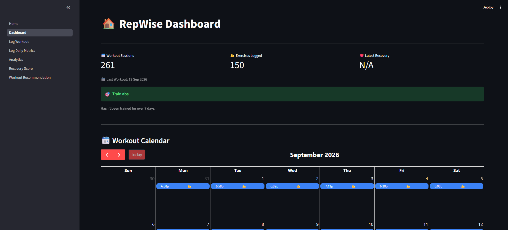
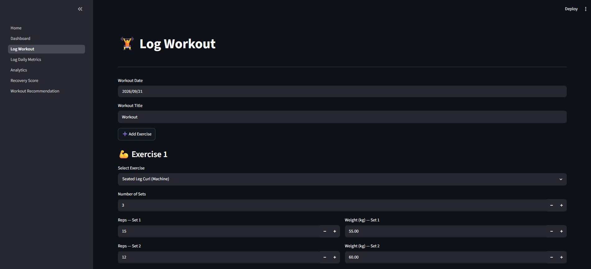
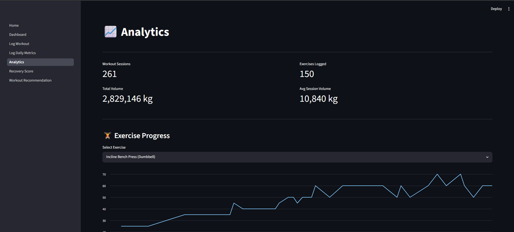
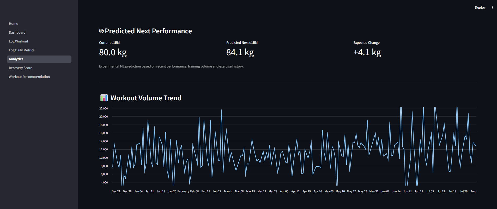
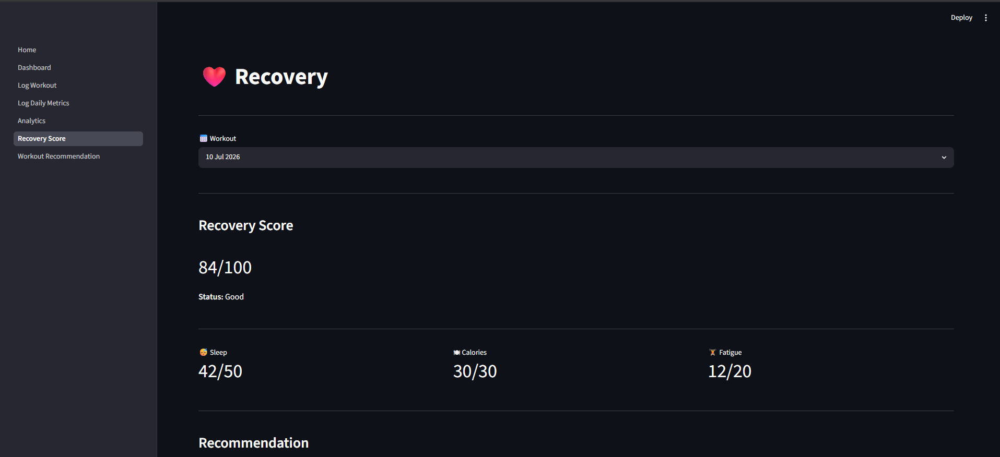
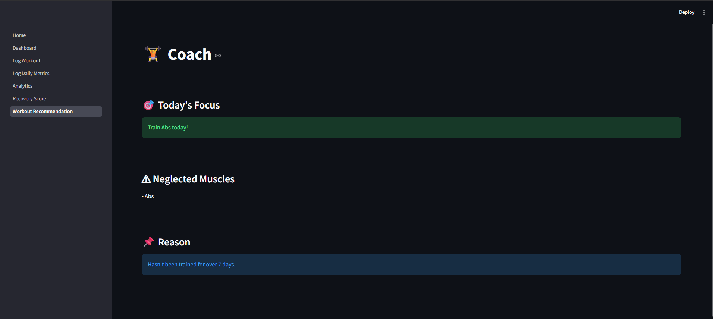
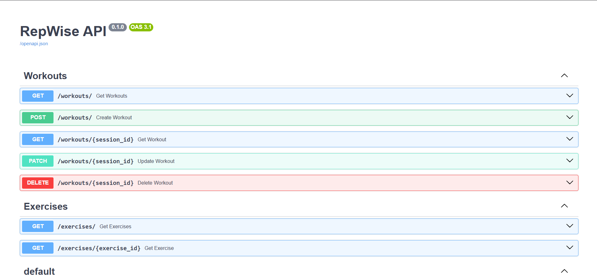

# RepWise

**RepWise** is a Python fitness tracking and analytics application that combines workout logging, recovery scoring, rule-based recommendations, and machine-learning performance predictions. It uses a **Streamlit** interface, a **FastAPI REST backend**, and **SQLite** for persistent workout data.

I built RepWise to apply software engineering, databases, data analysis, and ML to real workout history.

## Features

- **Workout tracking:** Log sessions, exercises, sets, reps, weights, daily metrics, and personal records.
- **Interactive dashboard:** Workout calendar, session history, training statistics, and progress charts.
- **Analytics:** Training volume, exercise progress, bodyweight trends, and estimated 1RM (e1RM).
- **Recovery scoring:** A 0–100 score based on sleep, calories, bodyweight, and relative workout fatigue.
- **Workout recommendations:** Rule-based muscle priorities considering training recency and primary/secondary muscle involvement.
- **ML predictions:** Linear Regression predicts next-session e1RM changes from historical exercise-session features, with live predictions in Streamlit.
- **FastAPI backend:** REST endpoints for creating, listing, retrieving, partially updating, and deleting workouts; exercise lookup; Pydantic validation; SQLite transactions and cascading deletes.

## FastAPI REST API

RepWise provides a RESTful API built with **FastAPI and Pydantic**, supporting workout CRUD operations, exercise retrieval, request validation, and SQLite transactions with cascading deletes.

The backend separates request/response models (`api/models/`) from route handlers (`api/routers/`). It uses SQLite with foreign-key enforcement and separate development/production database configurations.
- **Endpoints:** `GET`, `POST`, `PATCH`, `DELETE`
- **Testing:** pytest with an isolated SQLite test database
- **API Documentation:** Swagger UI at `/docs`

## Machine Learning v0.1

**Goal:** Predict the change in an exercise's estimated 1RM at its next session.

```text
Historical workout sets → Exercise-session features → Linear Regression
→ Predicted e1RM change → Predicted next-session e1RM → Streamlit
```

Features include previous e1RM and volume, rolling averages, historical best e1RM, days since last session, and exercise-session count. The dataset uses a chronological 80/20 train/test split to avoid mixing future observations into training.

| Evaluation | Result |
|---|---:|
| Usable exercise-session samples | 1,545 |
| Training / testing samples | 1,236 / 309 |
| Next-e1RM MAE | **7.54** |
| Next-e1RM RMSE | **12.00** |
| Delta R² | **0.363** |
| Naive baseline MAE | **8.57** |

The naive baseline predicts that the next e1RM equals the current e1RM. This first model is experimental; session-to-session performance is influenced by fatigue, technique, exercise setup, and other noisy factors.

## Database & Data Pipeline

RepWise stores sessions, exercises, sets, and daily metrics in **SQLite**, using primary/foreign keys, indexes, transactions, and duplicate-session protection. Historical workouts can be imported incrementally from **Hevy CSV exports** using Pandas for cleaning and validation.

```text
Hevy CSV → Pandas validation/cleaning → SQLite → Analytics / Recovery / ML
                                             ↕
                                        FastAPI CRUD
                                             ↕
                                        API clients
```

## Tech Stack

| Area | Technologies |
|---|---|
| Language | Python, SQL |
| Backend/API | FastAPI, Pydantic, Uvicorn |
| Database | SQLite |
| Data analysis | Pandas, NumPy |
| Machine learning | scikit-learn, Joblib |
| UI & visualization | Streamlit, Matplotlib |
| Testing | pytest, HTTPX / FastAPI TestClient |
| Version control | Git, GitHub |

## Project Structure

```text
repwise/
├── api/
│   ├── main.py                   # FastAPI application
│   ├── __init__.py
│   ├── models/
│   │   ├── exercise.py
│   │   ├── metric.py
│   │   ├── workout.py
│   │   ├── workout_create.py
│   │   └── workout_update.py
│   └── routers/
│       ├── __init__.py
│       ├── exercises.py
│       ├── metrics.py
│       ├── predictions.py
│       ├── recovery.py
│       └── workouts.py          # Workout CRUD endpoints
├── database/
│   ├── connection.py            # SQLite connections & schema
│   ├── queries.py
│   ├── schema.py 
├── data/                       # Local database and Hevy CSV 
├── importers/
│   └── migrate.py
|   └── migrate_daily_metrics.py 
├── ml/
│   ├── dataset.py
│   ├── features.py
│   ├── train.py
│   ├── predict.py
│   └── models/
├── src/
│   ├── Home.py                  # Streamlit entry point
│   ├── main.py                  # CLI entry point
│   ├── tracker.py
│   ├── recovery.py
│   ├── recommendation_engine.py
│   └── pages/                  # Streamlit dashboard & pages 
├── tests/
│   └── test_workouts_api.py    # Isolated FastAPI CRUD tests
├── tools/
├── project_docs/
├── screenshots/
├── requirements.txt
└── README.md
```

## Getting Started

Clone the repository and install dependencies:

```powershell
git clone https://github.com/aryansachdeva1718-web/repwise.git
cd repwise
python -m pip install -r requirements.txt
```

**Run the Streamlit app:**

```powershell
python -m streamlit run src/app.py
```

**Run the FastAPI backend** (requires an existing `data/repwise_test.db`):

```powershell
$env:REPWISE_ENV = "development"
$env:REPWISE_DB_PATH = "data/repwise_test.db"
python -m uvicorn api.main:app --reload
```

Open **http://127.0.0.1:8000/docs** for interactive Swagger documentation. Development mode uses the test database by default; do not run API tests against production workout data.

**Run automated API tests:**

```powershell
python -m pip install pytest httpx
python -m pytest tests/test_workouts_api.py -v
```

**Import newer Hevy data / retrain ML:**

```powershell
python -m tools.test_import
python -m ml.train
```

## Screenshots


| Dashboard | Workout History |
|---|---|
|  |  |

| Analytics | ML Prediction |
|---|---|
|  |  |

| Recovery | Recommendations |
|---|---|
|  |  |

| FastAPI Backend |
|---|
|  |


## Development Milestones

- **Workout logging, recovery, recommendations, and muscle tracking:** Core fitness logic.
- **Streamlit dashboard:** Workout logging, analytics, recovery, and recommendations.
- **SQLite migration and integration:** Relational storage and incremental Hevy imports.
- **ML v0.1:** Chronological evaluation, delta-e1RM prediction, and Streamlit inference.
- **FastAPI backend:** Workout CRUD, Pydantic models, foreign-key cascades, and automated pytest coverage.

**Next:** Improve ML feature quality and per-exercise evaluation.
